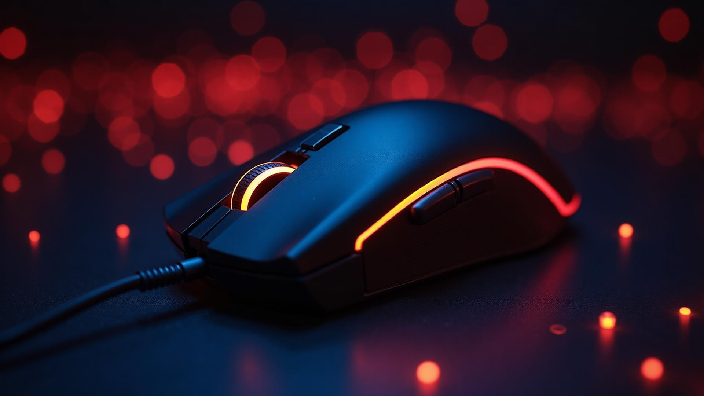

# Gaming Mouse — Premium Product Landing Page

A dark, product-first landing page for a premium gaming mouse brand, built with React, TypeScript, Vite, and Tailwind CSS.

[](https://react.dev/)
[](https://www.typescriptlang.org/)
[](https://vitejs.dev/)
[](https://tailwindcss.com/)
[](https://ui.shadcn.com/)

**[Live Demo](https://gamingmouse.lovable.app/)** · **[Source Code](https://github.com/Tuandaca/gamingmouse)**

## Project Overview

Gaming Mouse is a single-page marketing website for **GAMEMOUSE**, a concept brand focused on high-performance gaming peripherals. The site presents three mouse models, their specifications, and the technology behind them in a layout designed to feel closer to a premium hardware launch than a generic product page.

The project is aimed at gamers and tech enthusiasts, while also serving as a frontend portfolio piece for clients and recruiters who want to evaluate visual design, component structure, and responsive implementation. The design direction is intentionally dark and high-contrast: near-black surfaces, bold display typography, an orange-to-amber gradient, and restrained glow effects that draw attention to products and calls to action.

> **Note:** This is a static product showcase, not a working e-commerce store. Product names, prices, specifications, statistics, timeline entries, and brand references are demo content. There is no cart, checkout, authentication, payment flow, or backend.

## Live Preview

**[gamingmouse.lovable.app](https://gamingmouse.lovable.app/)**

<p align="center">
  <a href="https://gamingmouse.lovable.app/"></a>
</p>

<p align="center"><em>Hero visual from the landing page.</em></p>

## Key Features

- **Full-screen hero section** — photographic background, gradient overlay, oversized gradient headline, primary and secondary calls to action, and an animated scroll cue.
- **Fixed navigation** — blurred, semi-transparent navbar with in-page anchors for Features, Products, Technology, and About on desktop.
- **Product showcase** — three product cards with status badges, pricing, DPI, weight, battery, and connection type, plus image zoom and glow effects on hover.
- **Feature and technology sections** — six benefit cards and four technology deep-dives, each with a concise description and specification list.
- **Brand and story sections** — a six-item brand strip, company values, a 2018–2024 timeline, and a closing call-to-action panel.
- **Responsive layouts** — fluid containers, breakpoint-driven grids, scaling headings, and stacked calls to action across mobile, tablet, and desktop.
- **Reusable UI system** — shared `Button`, `Card`, and `Badge` primitives from shadcn/ui, centralized design tokens, and a `cn()` class-merging utility.
- **Client-side routing** — a single landing route plus a styled 404 fallback page.

## Technology Stack

| Technology | Role in the project |
| --- | --- |
| **React 18** | Component-based UI composition |
| **TypeScript 5** | Typed components and configuration |
| **Vite 5** | Development server and production bundling |
| **Tailwind CSS 3** | Utility styling, responsive breakpoints, and theme extension |
| **shadcn/ui + Radix UI** | Accessible UI primitives used by buttons, cards, and badges |
| **Lucide React** | Icon set used throughout the shadcn/ui primitives |
| **React Router 6** | Client-side routing for the landing page and 404 route |
| **ESLint 9** | Static analysis via `npm run lint` |

## Project Structure

```text
gamingmouse/
├── public/                  # Favicon, robots.txt, and static files
├── src/
│   ├── assets/              # Hero and product imagery
│   ├── components/
│   │   ├── ui/              # shadcn/ui primitives
│   │   ├── Navbar.tsx
│   │   ├── Hero.tsx
│   │   ├── BrandLogos.tsx
│   │   ├── Features.tsx
│   │   ├── Products.tsx
│   │   ├── Technology.tsx
│   │   ├── About.tsx
│   │   └── Footer.tsx
│   ├── hooks/               # Toast and mobile helpers
│   ├── lib/utils.ts         # Class-name utility
│   ├── pages/
│   │   ├── Index.tsx        # Landing page composition
│   │   └── NotFound.tsx     # 404 route
│   ├── App.tsx              # Providers and routes
│   ├── index.css            # Theme tokens and base styles
│   └── main.tsx             # Application entry point
├── index.html
├── tailwind.config.ts
├── vite.config.ts
└── package.json
```

## Getting Started

### Prerequisites

- Node.js 18 or newer
- npm

### Installation

```bash
git clone https://github.com/Tuandaca/gamingmouse.git
cd gamingmouse
npm install
```

### Development

```bash
npm run dev
```

The Vite development server runs at **http://localhost:8080** by default, as configured in `vite.config.ts`.

### Production Build

```bash
npm run build
```

The optimized static bundle is written to `dist/`.

### Preview the Build

```bash
npm run preview
```

### Other Scripts

| Command | Description |
| --- | --- |
| `npm run lint` | Run ESLint across the project |
| `npm run build:dev` | Build in development mode |

## Design Approach

**A dark, high-contrast foundation.** The interface uses a near-black background (`hsl(0 0% 7%)`) with off-white text, an orange primary gradient, and a cyan accent. This creates the visual language associated with competitive gaming hardware while keeping product imagery dominant.

**Typography with a clear hierarchy.** Oversized, bold display headings carry the hero and section titles, while muted body copy supports scanning. Uppercase micro-labels are used sparingly for badges and specification keys.

**Product-first composition.** The page follows a deliberate sequence: hero statement, brand strip, benefits, product lineup, technology details, brand story, and closing call to action. Each section introduces one idea, avoiding competing focal points.

**Depth without visual noise.** Translucent cards, thin borders, backdrop blur, and soft glow shadows are applied selectively. Motion is limited to hover states, image scaling, and the scroll indicator, so the page stays readable and performant.

**Consistent components and tokens.** Shared `Card`, `Button`, and `Badge` components, a common `0.75rem` corner radius, and CSS variables for color, gradients, and shadows keep the interface coherent as sections change.

**Responsive by default.** Layouts collapse from three columns to two and then one, headings scale down, and calls to action stack on small screens. Non-essential desktop navigation links are hidden on mobile to preserve space.

## Deployment

The live site is published at **[gamingmouse.lovable.app](https://gamingmouse.lovable.app/)** through Lovable.

The project compiles to a static site, so the `dist/` output can be hosted on any static hosting provider. Because the app uses client-side routing, the host should be configured to serve `index.html` as the fallback for unknown routes. No provider-specific deployment configuration is included in this repository.

## Author

**Tuandaca** — Frontend Developer

- GitHub: [github.com/Tuandaca](https://github.com/Tuandaca)
- Portfolio: [tuandacadev.vercel.app](https://tuandacadev.vercel.app/)

## License

No `LICENSE` file is included in this repository. The code is not offered under an open-source license, and reuse or redistribution requires permission from the author.
